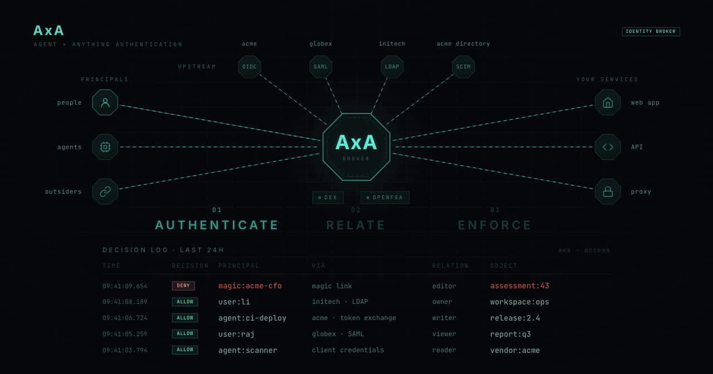

# AxA

**Agent x Anything Authentication: one Go library that signs in people, agents and outsiders, and decides what each may touch.**

The caller on the other end of an API request is no longer just a person. AxA
authenticates everything in one chain and authorizes it all in one place:

- **People** sign in through the IdP they already use: an embedded Dex brokers
  OIDC, SAML and LDAP, with TOTP and WebAuthn as a second factor.
- **Agents** carry credentials the service issues itself: personal access
  tokens, agent tokens and the OAuth `client_credentials` grant.
- **Outsiders**, like a vendor filling in a single form, get a single-use magic
  link scoped to one object, never an account.
- **Everyone** ends up as the same `Claims`, and a single OpenFGA relationship
  check decides their access.



AxA is built to be embedded. Your application imports `github.com/ArmornetIO/axa`;
it never imports yours.

## Status

**Alpha (`0.0.x`).** There is no compatibility promise between releases yet, so
pin an exact version in your `go.mod`. The core security invariants are tested:
a recognised but invalid credential never falls through to a weaker one, and
client secrets are always stored as argon2id hashes.

## Quick start

The fastest way to see AxA working is [`examples/gin-basic`](examples/gin-basic):
a Gin API behind AxA's browser sign-in, using one Postgres and a mock IdP.

```sh
cd examples/gin-basic
docker compose up -d          # Postgres on :5433
go run .                      # the API on http://localhost:8081
```

Its whole guard is a ten-line `requireSession` middleware over AxA's session
lookup, and a protected route reads the signed-in principal from it:

```go
api := r.Group("/api", requireSession(auth))
api.GET("/hello", func(c *gin.Context) {
	sess := c.MustGet("session").(authn.SessionRecord)
	c.JSON(http.StatusOK, gin.H{"hello": sess.Subject, "org_id": sess.OrgID})
})
```

Need your own UI? [`examples/custom-login`](examples/custom-login) puts a
designed login page over the same flow.

## Design: seams and state

**The module defines seams; the host implements them.** AxA handles the state
machines of authentication and authorization. Persistence, delivery (such as
sending email) and your domain decisions are interfaces you implement, such as
`PATLookup`, `MagicLinkStore` and `Notifier`.

**You own the database.** AxA ships a Postgres store (`pgstore`), but it never
migrates or takes over your database:

- You pass in an opened `*sql.DB`.
- `pgstore.Schema()`, `dex.Schema()` and `fga.Schema()` return the reference DDL.
- You fold those tables into your own migration pipeline.

So your own tables, such as `tenants` or `workspaces`, can reference AxA's
`users` and `organizations` with ordinary foreign keys.

## Development

AxA is split into several modules (`authn`, `authz`, `ginauthz`), so `./...`
from the root doesn't reach them all. To vet and test everything:

```sh
for m in . authn authz ginauthz; do (cd $m && go vet ./... && go test ./...); done
```

## Security and license

- **Security:** to report a vulnerability privately, see [SECURITY.md](SECURITY.md).
- **License:** [Apache-2.0](LICENSE).
